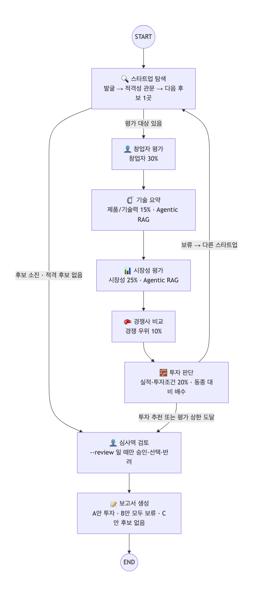

# AI Startup Investment Evaluation Agent
공개 정보만으로 AgTech AI 스타트업을 찾아 평가하고, 투자 · 보류 판단과 근거를 5쪽 이내 보고서로 만드는 LangGraph 멀티 에이전트입니다.

SKALA 울산캠퍼스 2반 1조 · [투자 보고서 PDF](outputs/RAG-Output_%EC%9A%B8%EC%82%B0-2%EB%B0%98_%EA%B9%80%EA%B0%80%EC%97%B0%2B%EA%B9%80%EC%A7%84%EB%85%95%2B%EB%AC%B8%EC%A7%80%ED%9B%84%2B%EC%9D%B4%EC%A4%80%ED%9D%AC%2B%EC%A0%95%EC%8A%B9%EC%9A%B0.pdf) · [설계서 PDF](docs/RAG-Design_%EC%9A%B8%EC%82%B0-2%EB%B0%98_%EA%B9%80%EA%B0%80%EC%97%B0%2B%EA%B9%80%EC%A7%84%EB%85%95%2B%EB%AC%B8%EC%A7%80%ED%9B%84%2B%EC%9D%B4%EC%A4%80%ED%9D%AC%2B%EC%A0%95%EC%8A%B9%EC%9A%B0.pdf)

> [!IMPORTANT]
> **메타파머스 투자 추천(실사 조건부)** — 동종 평균 100 대비 **107.2**, 창업자 기준 106.9, 동종 10곳 중 1위<br>
> 적격 14곳 중 10곳 평가 → 투자 기준 통과 4곳 중 1위 · 24문항 중 미확인 65% → 실사 5개 항목을 조건으로 추천

## Overview
- **Objective** : 비상장 · Seed\~Series C · Exit 전 AgTech AI 스타트업을 창업자 · 시장성 · 제품/기술 · 경쟁 · 실적 · 투자조건 6개 기준으로 평가해 **투자 / 보류** 판단
- **Method** : LangGraph Multi-Agent 7개 · Agentic RAG(문서 15종 199쪽 + 웹) · Scorecard(Payne) 동종 비교 + Bessemer 체크리스트 → 24문항
- **원칙** : LLM 은 원문 인용을 찾아 문항에 답만 하고, 인용 검증 · 점수 · 결정은 코드가 한다

## Features
- **후보 발굴 · 적격성 관문** : 공개 채널 8개에서 78곳 발굴 → 비상장 · 단계 · Exit 전 등 관문 G1\~G6 → 적격 14곳 (확인 못 하면 탈락)
- **Agentic RAG** : 질문마다 문서/웹 도구 선택 → 관련성 판정 → 질의 재작성(최대 2회) → 인용 답변 → 근거 점검
- **근거 없으면 '미확인'** : YES · NO 는 원문 인용이 있을 때만 인정, 날짜 · 제3자 · 회사명 규칙은 코드가 재검사
- **동종 비교 판정** : 투자 = 동종 평균(100) 초과 ∧ 창업자 점수 동종 평균 이상 ∧ Deal-killer 없음
- **보고서 자동 검사** : 5쪽 · SUMMARY 반 쪽 · REFERENCE 형식 · 평가표 일치를 PDF 렌더링 후 확인
- **키 없는 재현** : 검색 · LLM 응답 · 색인을 `replay/` 에 저장 → `python app.py` 한 줄로 같은 보고서

## Tech Stack
| 구분 | 사용 |
|---|---|
| Framework | LangGraph, LangChain (Python 3.11) |
| LLM / Generator · Judge | gpt-4.1-mini (temperature 0) |
| Retrieval | FAISS + Kiwi BM25 하이브리드 (BM25 0.4 : Dense 0.6, RRF) · Hit@4 0.986 · MRR@4 0.831 |
| Embedding | nlpai-lab/KURE-v1 (오픈소스, 후보 6종을 자체 질문 70개로 비교해 선정) |
| 외부 데이터 | Serper · Tavily 웹 검색, 한국거래소 KIND, 국민연금 사업장, TIPS, OpenDART 공시(`DART_API_KEY`, 없으면 건너뜀) |
| 보고서 | Jinja2 + Playwright (PDF) |

## Agents
| 에이전트 | 역할 | Scorecard 기준 |
|---|---|---|
| 스타트업 탐색 | 발굴 → 적격성 관문 → 다음 후보 1곳 | 관문 |
| 창업자 평가 (추가) | 창업 시점 t0 고정 → 창업 전 전문성 · 창업 후 24개월 실행력 | 창업자 30% |
| 기술 요약 | 핵심 기술 · 차별점을 분야 기술 기준선과 비교 (**Agentic RAG**) | 제품/기술 15% |
| 시장성 평가 | 하위 질문 3\~6개 × 문서/웹 선택 (**Agentic RAG**) | 시장성 25% |
| 경쟁사 비교 | 같은 제품 유형 경쟁사와 비교 | 경쟁 10% |
| 투자 판단 | 실적 · 투자조건 판정 → 동종 대비 배수 → 투자/보류 · 실사 항목 | 실적 10% · 투자조건 10% |
| 보고서 생성 | 5쪽 PDF, 형식 · 평가표 일치 검사 | — |

## Architecture


- 후보 1곳씩 탐색 → 창업자 → 기술 → 시장 → 경쟁 → 투자 판단, 판단 뒤 다음 후보로 (최대 10곳)
- 평가 상한 · 후보 소진 → 👤 심사역 검토(`--review` 일 때만 승인·선택·반려) → 보고서. 대상은 투자 기준 통과 후보 중 동종 대비 배수 1위 (없으면 모두 보류 보고서)
- 액터 · 실행 순서 · 액터별 실패 처리: [docs/actors.md](docs/actors.md)
- 상한 : 발굴 2라운드 · 평가 10곳 · RAG 재작성 2회 · recursion_limit 100 · LLM 비용 1회 $1.5

## Directory Structure
```text
├── app.py          # 실행 (재현 · 새 평가 · 보정)
├── config.yaml     # 모델 · 상한 · 판단 기준
├── rubric.yaml     # 평가표 24문항 · Deal-killer · 결정 규칙
├── agents/         # 에이전트 7개
├── graph/          # State(5칸 · 실패 기록) · 메인 그래프 · 분기 · 노드 실패 처리
├── rag/            # 청킹 · 임베딩 · 하이브리드 검색 · Agentic RAG
├── core/           # 평가표 판정 · 문장 충실성 검사 · LLM 호출 상한
├── tools/          # 웹 검색 · 상장 목록 · 국민연금 · DART · 근거 저장소 · 포털 원문 찾기
├── data/           # RAG 문서 15종 199쪽 · 동종 기준 집단 · 평가 정답
├── docs/           # Goal 명세(성공 기준) · README 템플릿
├── eval/           # 검색 · 적격성 · Judge · 양성 대조 · 성공 기준 측정
├── outputs/        # 보고서 PDF · 실행 로그 · 평가 결과
├── replay/         # 재현용 캐시
└── tests/
```

## Usage
```bash
python3.11 -m venv .venv && source .venv/bin/activate
pip install -r requirements.txt
python -m playwright install chromium
python app.py              # API 키 없이 제출 보고서 재현 → outputs/
```
- 새로 평가 (`.env` 에 `OPENAI_API_KEY`, `SERPER_API_KEY` 또는 `TAVILY_API_KEY`) : `python app.py --fresh --calibrate` → `python app.py --fresh`
- 심사역 승인 받고 보고서 쓰기 : `python app.py --review` (보고서 직전에 멈춤 → `approve` · `pick:후보 이름` · `reject:사유`)
- 성공 기준 측정 : `python -m eval.success_criteria` (무료) · 반복 실행 안정성 : `python -m eval.eval_passk --k 3` (유료, LLM 만 새로 호출)
- 테스트 : `python -m pytest`

## 투자 평가 결과
| 순위 | 후보 | 단계 · 지역 | 동종 평균 대비 | 창업자 기준 | 판정 |
|---|---|---|---|---|---|
| 1 | 메타파머스 | Pre-A · 국내 | 107.2 | 106.9 | **투자** |
| 2 | 새팜 | Pre-A · 국내 | 107.2 | 106.9 | **투자** |
| 3 | Bonsai Robotics | Series A · 해외 | 106.5 | 106.9 | **투자** |
| 4 | 에임비랩 | Pre-A · 국내 | 102.4 | 120.8 | **투자** |
| 5 | 퓨처커넥트 | Series A · 국내 | 101.7 | 93.1 | 보류(창업자 점수 평균 미만) |
| 6 | Upside Robotics | Seed · 해외 | 98.1 | 93.1 | 보류(창업자 점수 평균 미만) |
| 7 | Nature Robots | Seed · 해외 | 96.8 | 93.1 | 보류(창업자 점수 평균 미만) |
| 8 | 리비타 | Seed · 국내 | 95.4 | 93.1 | 보류(창업자 점수 평균 미만) |
| 9 | 트랙팜 | Seed · 국내 | 95.4 | 93.1 | 보류(창업자 점수 평균 미만) |
| 10 | 바르카 | Pre-A · 국내 | 89.9 | 93.1 | 보류(창업자 점수 평균 미만) |

- **메타파머스 기준별** : 창업자·팀 106.9 · 시장성 108.3 · 제품/기술력 101.9 · 경쟁 우위 104.2 · 실적 98.6 · 투자조건 125.0
- **실사 확인 항목** : 기술 책임자 이력·특허 발명자·논문 목록 · 최근 24개월 마일스톤 증빙 · 회사 공개 수치의 원자료 · 농가 투자 회수기간(payback)·효과 실측 · 가격표·과금 구조·지불 주체
- **검증자 이견 (YES 판정 유지, 실사로 확인)** : F1 창업팀 이력 · C3 데이터 축적 구조 · D4 자본집약도
- 메타파머스 · 새팜 배수 동점(107.2)은 미리 정한 동점 규칙(창업자 점수 → 확인된 YES 수 → NO 수 → 이름)으로 정함 — 확인된 YES 8 대 7
- 적격 4곳은 평가 상한으로 미평가 · 결론은 2026-09-30 수집 자료 기준

## Evaluation
| 항목 | 결과 |
|---|---|
| 검색기 (70문항) | Hit@4 0.986 · MRR@4 0.831 |
| 검색기 (실제 에이전트 질의 63개, LLM 관련성 판정) | Precision@4 0.627 · Hit@4 0.841 — 대안 최고 dense only 0.563, 런타임 유지 |
| RAG 답변 (LLM Judge, 20문항) | Relevance 1.00 · Faithfulness 1.00 · Correctness 0.95 |
| 적격성 판정 | 0.95 (홀드아웃 1.00) |
| YES 검증자 이견 (판정 유지, 실사 표시) | YES 52개 중 24개 |
| 양성 대조 (실제 투자받은 기업) | 3곳 중 추천 1곳 |
| 기준 민감도 | 100 → 4곳 · 105 → 3곳 · 110 → 0곳 · 115 → 0곳 · 120 → 0곳 |
| 보고서 형식 | 5쪽 · REFERENCE 21건 · 평가표 불일치 0건 |

### 성공 기준 ([Goal 명세](docs/goal.md))
통과 6 · 미달 4 · 미측정 0

| 기준 | 목표 | 투자 보고서 | 보류 시나리오 | 판정 |
|---|---|---|---|---|
| 근거성 — 출처 명시율 | 100% | 100% | 83% | ❌ |
| 충실성 — 근거가 문장을 뒷받침 | ≥ 95% | 90% | 92% | ❌ |
| 완결성 — 필수 항목 | 100% | 통과 | 통과 | ✅ |
| 일관성 — 상충 진술 | 0건 | 0건 | 0건 | ✅ |
| 형식 — 분량·REFERENCE | 통과 | 통과 | 통과 | ✅ |
| 원 출처 — 포털 전재본 | 0건 | 0건 | 1건 | ❌ |
| 오류 처리 — 근거 없는 YES | 0건 | 0건 | 0건 | ✅ |
| 안정 운영 — 노드 실패 | 0건 | 0건 | 0건 | ✅ |
| 비용 — 새로 평가 1회 | ≤ $1.00 | $0.96 | $0.96 | ✅ |
| 안정성 — 반복 실행 | K=3 일치 | 2/3 대상 일치 | - | ❌ |

## Lessons Learned
| 문제 | 바꾼 것 |
|---|---|
| 70점 · 110 같은 임의 기준은 근거를 댈 수 없었다 | Scorecard 원 방법의 기준점(동종 평균 100) |
| LLM 은 근거를 못 찾으면 NO 라고 썼다 | NO 에도 반대 사실의 원문 인용 요구 |
| 형식 검사는 통과해도 내용 오류가 있었다 | 인용 · 제3자 · 날짜 규칙을 코드로 |
| Hit@8 로 고른 검색기가 실제 설정(앞 4개)에선 1위가 아니었다 | 실제 동작 기준 Hit@4 · MRR@4 로 재선정 |
| 예정 투자 · 검색 실패가 조용히 통과했다 | 날짜 규칙과 fail-closed |
| 평가 대상 분야에 기준 문서가 없었다 | 문서 2종 추가, 200쪽 한도 안(199쪽) |
| 문서를 보고 만든 70문항에선 Dense 가 1위, 실제 에이전트 질의에선 하이브리드가 1위 | 평가 세트는 실제 질의 분포를 닮아야 한다 — 런타임 하이브리드 유지 |
| LLM 검증자를 판정에 넣자 결과가 흔들렸다(표본 24건 중 약 10건 오판) | 검증자도 정확도를 재고 쓴다 — 판정은 코드 규칙, 검증자는 이견 표시만 |
| 해외 후보의 영문 근거가 한국어 검색어에 밀려 판정에서 빠졌다 | 평가표 문항마다 영어 검색어를 두고 모든 후보에 같게 적용 |
| 배수 동점을 평가 순서가 갈랐다 | 동점 규칙을 미리 고정: 창업자 점수 → 확인된 YES 수 → NO 수 → 이름 |
| 보고서 LLM이 두 기관의 시장 추정을 한 문장에 섞었고, 나눠 쓰라고 다시 시켜도 같은 문장을 썼다 | 숫자 규칙은 코드가 강제: 연평균이 맞지 않는 문장은 빼고 근거 원문의 같은 추정 값으로 바꾼다 |
| 시장 분석 프롬프트 한 줄을 바꾸자 판정이 다시 계산돼 1위가 바뀌었다(상위 3곳이 106.3\~110.5 사이) | 상위권 차이가 작으면 LLM 편차가 순위를 바꾼다 — 결론은 실사 대상 선별로 쓰고, 반복 실행 안정성 측정은 다음 과제 |
| 인용 번호만 검사해서, 같은 출처를 단 두 문장이 서로 다른 기관 수치였는데도 통과했다 | 문장마다 '근거가 이 문장을 뒷받침하는가'를 판정하고 통과율을 성공 기준(95%)과 비교 |
| State 를 키 22개짜리 한 덩어리로 두고, 실패 기록은 모듈 전역 변수에 있었다 | State 를 다섯 칸(실행·탐색·후보 작업·제어/실패·산출물)으로 나누고 errors·status 를 State 에 |
| LLM 캐시 없이 3번 새로 돌리자 보고서 대상이 2/3만 같았다 — 적격 14\~15곳 중 어느 10곳을 평가하느냐가 실행마다 달랐고, 평가하지 않았던 후보가 1위가 되기도 했다 | 같은 후보의 판정은 대체로 같았다(메타파머스 3/3 투자). 결론은 '평가한 후보 안에서의 1위'로 쓰고, 다음 과제에서 적격 후보 전부 평가 또는 관문 판정 고정 |
| 근거에 맞게 문장을 고치게 했더니, 보류 원인 문장을 근거에 있는 시장 성장률 문장으로 바꿔 판정만 통과했다 | 고친 문장은 원래 낱말을 60% 이상 지켜야 받는다(코드) — 점수가 아니라 뜻을 지키는지 본다 |

## 한계와 설계서 이후 변경
- 공개 정보 한계 : 추천 대상도 미확인 65%, 양성 대조 1/3 → 결론은 투자 결정이 아닌 **실사 대상 선별**
- 동종 기준 집단 10곳은 단계 · 지역이 섞인 근사
- 생성 · 판정 · 검증을 모두 gpt-4.1-mini 하나가 한다(모델 고정). 교차 검증(평가는 다른 모델)을 하지 않아 같은 모델의 편향이 함께 들어갈 수 있다
- **평가 흐름** : 설계서는 첫 투자 추천에서 멈춤 → 발굴 순서가 결론을 정하지 않도록 10곳 모두 평가 후 1위 선정
- **판단 기준 110 → 100** : 110 은 근거 없는 가정이라 원 방법 기준점으로. 결과가 나온 뒤의 변경이며, 110 결과(추천 0곳)도 민감도로 공개
- RAG 문서 13종 196쪽 → 15종 199쪽
- **수업 피드백 반영(2026-10-12)** : 성공 기준을 숫자로([Goal 명세](docs/goal.md)) · 문장 충실성 검사 · State 계층화와 실패 기록(분석 노드가 실패하면 그 기준은 투자 판단이 대신 판정하고 투자 추천에서 제외) · 포털 전재본은 원 매체 기사 주소로 · 👤 심사역 승인 게이트(`--review`) · LLM 비용 상한 · [액터와 오류 처리](docs/actors.md) · 반복 실행 안정성(PassK)
- **제출 후 개선(v3)** : 평가표 규칙을 코드로 강제(기술 책임자 학력만 · 계획 문장 · 수치 없는 인용 · 추정 이유는 YES 불인정, 제품명 인정), 경쟁사는 출처 2곳에서 확인된 2곳 이상, OpenDART 공시 교차 확인, 보고서 숫자 대조 검사, 동점 규칙. 같은 9월 30일 수집 자료로 다시 판정한 결과 대상은 메타파머스 유지, 투자 기준 통과 4곳

## Contributors
- 김가연 : 설계서 검토, 스타트업 발굴·적격성 검증 구현, 투자 판단 구현, 적격성 정답 라벨 검수, 보고서 사실 확인, 가이드 정렬 점검, 재현성 테스트, README 검토
- 김진녕 : 도메인·에이전트·State·평가표·보고서 목차 설계, RAG 문서 선정·임베딩 비교·Agentic RAG, 에이전트 구현(발굴\~보고서)·그래프·실행 스크립트, 검증(정답 라벨·보고서 사실·형식·가이드 정렬), 재현성 테스트, 제출, 발표 (AI 코딩 도구 활용)
- 문지후 : State·그래프 설계, 임베딩 후보 선정·비교, Agentic RAG 구현, 투자 판단 구현, 그래프 조립·실행 스크립트, 보고서 사실·형식 확인, 재현성 테스트
- 이준희 : State·그래프 설계, 문서 전처리·청킹, Agentic RAG 구현, 창업자·기술·시장성·경쟁사 분석 에이전트 구현, 그래프 조립·실행 스크립트, 재현성 테스트
- 정승우 : 도메인 선정·문제 정의, 에이전트 역할 설계, 투자 평가표 설계, 보고서 목차 설계, RAG 문서 수집·선정, 보고서 생성 구현, 가이드 정렬 점검
