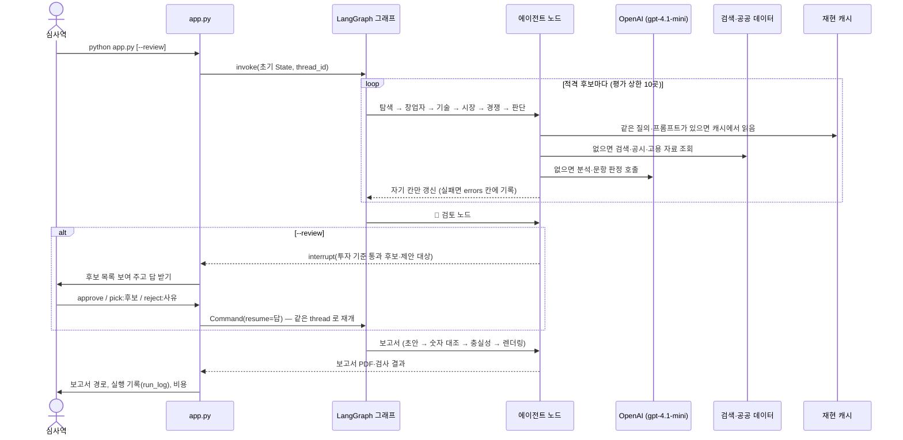

# 액터와 오류 처리

> "이 시스템의 액터는 누구입니까?"(2026-10-12 수업). 액터마다 맡는 범위가 다르면 데이터 흐름과 실패했을 때 할 일도 다르다.
> 아래 표의 처리는 모두 코드에 있는 동작이다(파일 위치 표기). 목표치는 [Goal 명세](goal.md).

## 액터

| 액터 | 종류 | 맡는 일 | 경계 |
|---|---|---|---|
| 심사역 | 사람 | 실행을 시작하고, `--review` 면 보고서 직전에 대상을 승인·선택·반려 | 판정 규칙·점수는 바꿀 수 없다(대상 선택은 투자 기준 통과 후보 안에서만) |
| 투자심의위원회 | 사람 | 보고서를 받아 실사 상정 여부를 결정 | 시스템 밖. 보고서 SUMMARY 의 '요청' 줄이 이 결정을 묻는다 |
| app.py | 실행기 | 옵션 반영, 그래프 실행, 멈춤·재개, 실행 기록·비용 기록 | 재현(`--offline`)·새 수집(`--fresh`)·보정·시나리오 모드 |
| LangGraph 그래프 | 런타임 | 노드 순서·분기(순수 함수), State 병합, 반복 상한 | `graph/builder.py` · `graph/routes.py` · `graph/state.py` |
| 에이전트 노드 8개 | 소프트웨어 | 탐색 → 창업자 → 기술 → 시장 → 경쟁 → 판단 → 👤검토 → 보고서 | 노드는 자기 State 칸만 쓴다(`graph/state.py` 다섯 칸) |
| OpenAI API (gpt-4.1-mini) | 외부 서비스 | 분석 · 판정(문항 YES/NO) · 검증 · 보고서 문장 · 충실성 판정 | 모델 고정. 점수 계산·결정·분기는 하지 않는다(코드가 한다) |
| 검색 공급자 (Serper → Tavily) | 외부 서비스 | 웹·뉴스 검색 | 블로그·커뮤니티·시장조사 홍보 페이지는 결과에서 제외 |
| 공공 데이터 (OpenDART · 국민연금 · TIPS 목록 · 거래소 상장 목록) | 외부 서비스 | 상장 여부·설립일·매출·고용 인원 확인 | 확인된 사실만 판정에 쓰고, '없음'은 감점 근거로 쓰지 않는다 |
| 기사·홈페이지 원문 | 외부 웹 | 근거 본문·게시일 보충 | 봇 차단 사이트는 받지 않는다 |
| 로컬 저장소 (RAG 코퍼스 · 재현 캐시) | 내부 | 기관 문서 검색(FAISS + BM25), LLM·검색·DART 응답 재생 | 저장소에 포함, API 키 없이 재현 |

## 실행 순서

## 액터별 실패와 처리

| 어디서 | 실패 | 처리 | 코드 |
|---|---|---|---|
| OpenAI | 일시 오류·시간 초과 | 호출마다 최대 3회 재시도, 제한 시간 120초 | `core/llm_bounded.py` |
| OpenAI | 출력이 같은 말을 반복해 길이 한도에 닿음 | 반복 금지 문구 + 반복 벌점으로 1회 다시, 그 프롬프트는 기록해 다음부터 바로 그 설정 | `core/llm_bounded.py` |
| OpenAI | 1회 실행 비용이 상한(`workflow.max_llm_usd`)에 닿음 | 다음 호출부터 막고 실행을 멈춘다. 제출용 기록은 덮어쓰지 않고 `run_log_stopped.json` 에 남긴다 | `core/cost.py` · `app.py` |
| OpenAI | 재현(`--offline`)인데 캐시에 없는 호출 | 바로 실패(같은 결과가 아니면 재현이 아니므로) | `core/llm.py` |
| 검색 공급자 | 한도 초과·인증 오류 | 그 공급자를 이번 실행에서 끄고 다음 공급자로 | `tools/web_search.py` |
| 검색 공급자 | 연결 실패·시간 초과 연속 3회 | 그 공급자를 끄고 다음으로. 모두 실패하면 '검색 실패'로 기록(결과 없음과 구분) | `tools/web_search.py` |
| 검색 공급자 | 검색 실패가 적격성 판단에 걸림 | 통과시키지 않는다(fail-closed). 보고서 한계점에 실패 건수 | `tools/web_search.py` · `agents/report.py` |
| 거래소 상장 목록 | 목록을 불러오지 못함 | 상장 여부 '확인 불가' → 관문을 통과시키지 않는다 | `tools/listing_check.py` |
| OpenDART | 키 없음·응답 오류·캐시 없음 | '확인 불가'로 두고 판정을 바꾸지 않는다(오류 메시지에서 키를 가림) | `tools/dart.py` |
| 국민연금 자료 | 회사를 못 찾음(3인 미만 법인 등) | 탈락 사유로 쓰지 않는다(보류 신호만) | `tools/nps.py` |
| 기사·홈페이지 원문 | 받기 실패·봇 차단 | 검색 스니펫으로 진행, 실패도 캐시에 표시해 재현 때 같은 결과 | `tools/fetch.py` |
| 포털 전재본 | 원 매체 기사를 못 찾음 | 포털 주소로 인용하고 한계점에 건수 | `tools/origin.py` |
| 분석 노드 (창업자·기술·시장·경쟁) | 예외 | 실행은 계속, State.errors 에 기록. 그 기준은 판단 노드가 근거로 대신 판정하고, 그 후보는 투자 추천하지 않는다 | `graph/builder.py` · `agents/decision.py` |
| 그래프 | 끝나지 않는 반복 | 평가 상한 10곳, 발굴 2라운드, recursion_limit 100, RAG 재작성 2회 | `config.yaml` |
| 보고서 | 형식·평가표 불일치 | 이유를 붙여 최대 2회 다시 쓰기 | `agents/report.py` |
| 보고서 | 숫자 경고(입력에 없는 숫자, 서로 다른 기관 추정을 이은 문장) | 1회 다시 쓰고 경고가 줄 때만 채택, 그래도 남은 성장률 불일치는 코드가 같은 기관 값으로 대체 | `agents/report.py` |
| 보고서 | 인용이 문장을 뒷받침하지 않음 | 인용 바로잡기 → 문장 하나씩 고쳐 쓰기(뜻이 바뀌면 받지 않음) → 1회 다시 쓰기(통과율이 오를 때만) | `core/faithfulness.py` · `agents/report.py` |
| 심사역 검토 | 형식이 틀린 답·기준 통과가 아닌 후보 | 'invalid' 로 기록하고 제안대로 진행(다시 묻지 않음) | `graph/review.py` |
| PDF 렌더링 | 브라우저(Chromium) 없음 | 실행 시작 때 바로 알리고 멈춘다(마지막 단계에서 실패하지 않게) | `app.py` |
